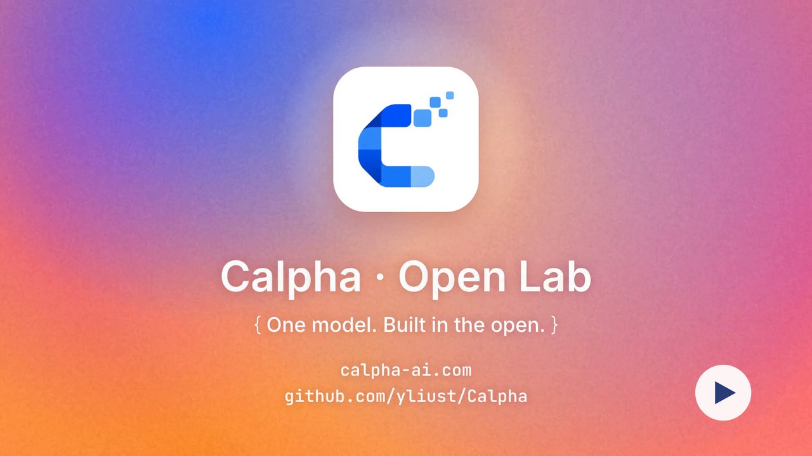
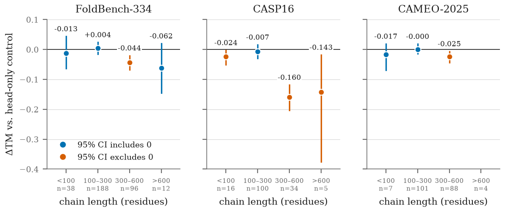

<p align="center"></p>

<h1 align="center">Calpha</h1>
<p align="center"><b>Toward native biomolecular intelligence in a general-purpose language model</b><br>
Technical Report I: Protein Folding</p>

<p align="center">
<a href="https://calpha-ai.com">Homepage</a> ·
Technical report (coming soon) ·
<a href="https://huggingface.co/liuyong9975/Calpha">Weights and data</a>
</p>

<p align="center">
<a href="https://github.com/yliust/Calpha/blob/main/assets/calpha_promo.mp4"></a><br>
<sub>Click to watch the 30-second introduction (with sound).</sub>
</p>

Calpha is an open project to make the molecular world a native modality of a general-purpose
language model. This repository holds the first step: a chat model that folds proteins. You ask
in plain language, the model answers with a `<structure>` token, and its hidden states drive a
structure generator in the same forward pass, with no tool call.

A protein sequence enters Qwen3.5-9B inside an ordinary chat turn, together with per-residue
features from frozen ESM2-3B. Hidden states from nine layers at the residue positions pass
through a small conditioning front-end (8.4M parameters) into the frozen SimpleFold-3B
flow-matching head, which generates all-atom coordinates. The head receives nothing else.

**What this release is, and is not.** Calpha folds single protein chains from sequence at
TM-score 0.807 / 0.635 / 0.900 on three held-out sets. It is below ESMFold, the language model
does not yet make folding more accurate than the same head without it, and the system depends
on two pretrained specialist models (ESM2 and SimpleFold). See [Limitations](#limitations).

## Models

| Model | What it is | Trained here | Weights |
|---|---|---|---|
| **Calpha** | Qwen3.5-9B + ESM2-3B features → front-end → frozen SimpleFold-3B head | language model and adapter (stage 1), front-end (stage 2) | [liuyong9975/Calpha](https://huggingface.co/liuyong9975/Calpha) |

The release contains the fine-tuned language model (bf16, 18 GB), the ESM2 adapter (27M
parameters) and the conditioning front-end (8.4M parameters). ESM2-3B and SimpleFold-3B are
**not redistributed**: the code downloads them from their original sources on first use.
Training data cut-off of the structure data: PDB chains used by SimpleFold's own training
split; the three test sets are filtered or dated as described in the report.

## Installation

Calpha needs one GPU with about 48 GB of memory, Linux, Python 3.12 and CUDA 12.

```bash
git clone https://github.com/yliust/Calpha.git && cd Calpha
conda create -n calpha python=3.12 -y && conda activate calpha
pip install -e .
pip install git+https://github.com/apple/ml-simplefold.git@94e2cd704cf7b86ef8e7cb27a1e77154c4e35b34
```

Qwen3.5 needs a recent `transformers` and the `flash-linear-attention` kernels; the versions we
ran are listed in [`requirements-frozen.txt`](requirements-frozen.txt).

## Quick start

```bash
# fold a sequence (or a FASTA file); writes predictions/<name>_sampled_0.cif
calpha fold MKTAYIAKQRQISFVKSHFSRQLEERLGLIEVQAPILSRVGDGTQDNLSGAEKAVQVKVKALPDAQFEVV

# ask in your own words; the model decides whether to fold
calpha chat "Can you show me what this protein looks like in 3D? {seq}" --seq MKTAYIAKQR...
calpha chat "How many residues does this protein have? {seq}" --seq MKTAYIAKQR...   # text, no structure
```

```python
from calpha import Calpha

model = Calpha.from_pretrained()                      # downloads from Hugging Face
out = model.fold("MKTAYIAKQRQISFVKSHFSRQLEERLGLIEVQ", out_dir="predictions")
print(out.structures)                                 # [predictions/target_sampled_0.cif]

ans = model.chat("What is the 3D structure of this protein?\n{seq}", seq="MKTAYIAKQR...")
print(ans.text, ans.triggered, ans.structures)
```

`fold` uses the one request the front-end was trained with and supplies the `<structure>`
answer itself; every benchmark number below was produced this way. `chat` lets the model
generate its own answer and folds only if that answer contains `<structure>`. Folding accuracy
under other phrasings has not been measured.

## Results

TM-score on alpha carbons, one sample per target, failures counted as zero, every system scored
by the same program ([`src/calpha/eval/score.py`](src/calpha/eval/score.py)). "No hom." is the
subset of targets with no homolog in the training pool.

| Model | FoldBench-334 | No hom. (128) | CASP16 (155) | No hom. (70) | CAMEO-2025 (200) | No hom. (16) |
|---|---|---|---|---|---|---|
| **Calpha** | **0.807** | **0.778** | **0.635** | **0.567** | **0.900** | **0.691** |
| Calpha-Joint (100M head, co-trained) | 0.744 | 0.717 | 0.582 | 0.502 | 0.845 | 0.631 |
| Calpha-Token (writes structure tokens) | 0.660 | 0.597 | 0.569 | 0.453 | 0.800 | 0.621 |
| Head-only control (ESM2 → SimpleFold-3B, no LLM) | 0.822 | 0.776 | 0.682 | 0.589 | 0.917 | 0.791 |
| ESMFold | 0.869 | 0.820 | 0.762 | 0.670 | 0.905 | 0.855 |
| SimpleFold-3B | 0.842 | 0.774 | 0.704 | 0.600 | 0.938 | 0.822 |
| ESM3-open | 0.787 | 0.720 | 0.643 | 0.543 | 0.852 | 0.739 |
| DPLM-2 (650M) | 0.656 | 0.582 | 0.515 | 0.428 | 0.757 | 0.608 |
| BioMatrix-4B (public weights, our protocol) | 0.158 | 0.164 | 0.163 | 0.161 | 0.311 | 0.145 |
| Nearest training structure (copy) | 0.547 | 0.159 | 0.469 | 0.072 | 0.844 | 0.242 |
| Random walk (floor) | 0.140 | 0.144 | 0.139 | 0.136 | 0.136 | 0.141 |

Against the head-only control, no loss is detected for chains of 100–300 residues on any set,
and the loss is significant for chains of 300–600 residues on all three:

<p align="center"></p>

Per-target scores of all 23 systems, paired comparisons with bootstrap intervals, the 16-sample
study and the trigger test are in [`results/`](results); raw predictions are on
[Hugging Face](https://huggingface.co/liuyong9975/Calpha/tree/main/benchmark_outputs). The rows
for third-party models describe their public weights under our protocol and are not a ranking
of the methods at their best; see the report for the caveats of each row.

## Reproducing the benchmark

```bash
bash scripts/reproduce_benchmark.sh foldbench334 8      # set name, number of GPUs
```

or step by step:

```bash
for i in 0 1 2 3 4 5 6 7; do
  CUDA_VISIBLE_DEVICES=$i calpha benchmark --set benchmarks/foldbench334.parquet \
      --out runs/foldbench334 --rank $i --world 8 &
done; wait
calpha score --set benchmarks/foldbench334.parquet --out runs/foldbench334
calpha compare runs/foldbench334/scores.csv results/scores/head_only_control/foldbench334/scores.csv
```

Sampling is stochastic (200 steps, τ = 0.01, seed 42 + shard index). With 8 shards, our rerun of
FoldBench-334 from the released files gave TM 0.8075, identical to the reported run target by
target. With another number of shards individual targets move while the mean stays close:
across 16 samples the single-sample mean is within 0.002 of the 16-sample mean on every set.
See [`docs/reproduce.md`](docs/reproduce.md) for what was checked.

## Training

Calpha is trained in two stages.

1. **Stage 1** fine-tunes all of Qwen3.5-9B, the ESM2 adapter and a small SimpleFold-100M head
   jointly, on protein tasks, general text and 84,658 PDB chains, for 2B tokens.
2. **Stage 2** freezes the language model, swaps in the frozen SimpleFold-3B head and trains
   only the 8.4M-parameter front-end: 20,000 steps at a crop of 256 residues, then 10,000 steps
   at 512, about 11 hours on eight H200 GPUs.

The code as used for the report is in [`training/`](training), with its own README. The
training data is on [Hugging Face](https://huggingface.co/liuyong9975/Calpha/tree/main/training_data).

## Repository layout

```
src/calpha/          inference package: language model, adapter, structure head, CLI
src/calpha/eval/     benchmark runner, scorer, paired comparison
benchmarks/          the three test sets, homology search hits, the 180-target subset
results/             per-target scores of every system in the report
training/            stage-1 and stage-2 training code, data builders, launch scripts
scripts/             reproduction scripts
docs/                reproduction notes, model details
```

## Limitations

- **The language model does not make folding more accurate.** Calpha is below the same head
  reading ESM2 directly on two of three sets, and below ESMFold on FoldBench-334 and CASP16.
- **Long chains.** Above 300 residues the language model costs accuracy on every set.
- **Specialist weights.** Protein features come from ESM2 and structural knowledge from
  SimpleFold; a head trained from scratch at our data scale reached TM 0.27.
- **General ability.** MMLU-Pro accuracy fell from 0.774 to 0.703 during protein training.
- **Scope.** Single chains, single sequence, no ligands or complexes. Accuracy is computed on
  alpha carbons only; side chains, clashes and local geometry were not evaluated.
- **One run per configuration.** Confidence intervals cover the choice of targets, not
  retraining.

## Citation

```bibtex
@techreport{liu2026calpha,
  title  = {Calpha: Toward Native Biomolecular Intelligence in a General-Purpose Language Model.
            Technical Report I: Protein Folding},
  author = {Liu, Yong},
  year   = {2026},
  url    = {https://calpha-ai.com}
}
```

## Acknowledgements and licenses

The code in this repository is released under the [Apache License 2.0](LICENSE). Calpha is
built on, and at run time downloads, third-party models with their own terms
([`NOTICE`](NOTICE)):

- [Qwen3.5-9B](https://huggingface.co/Qwen/Qwen3.5-9B) (Apache 2.0): the language model we
  fine-tuned; our weights are a derivative of it.
- [SimpleFold](https://github.com/apple/ml-simplefold) (code MIT; **weights under the Apple
  Machine Learning Research Model License, research use only**): the structure head and the
  data pipeline. Because the head is required to produce structures, Calpha as a whole can only
  be used under those terms.
- [ESM2](https://github.com/facebookresearch/esm) (MIT): the protein encoder.
- Baselines: ESMFold, ESM3, DPLM-2, MultiFlow, BioMatrix, OpenDDE, and the CASP, CAMEO, PDB and
  AlphaFold DB data resources.

We would like to hear from you: open an issue, or write to liuyong9975@sjtu.edu.cn.
